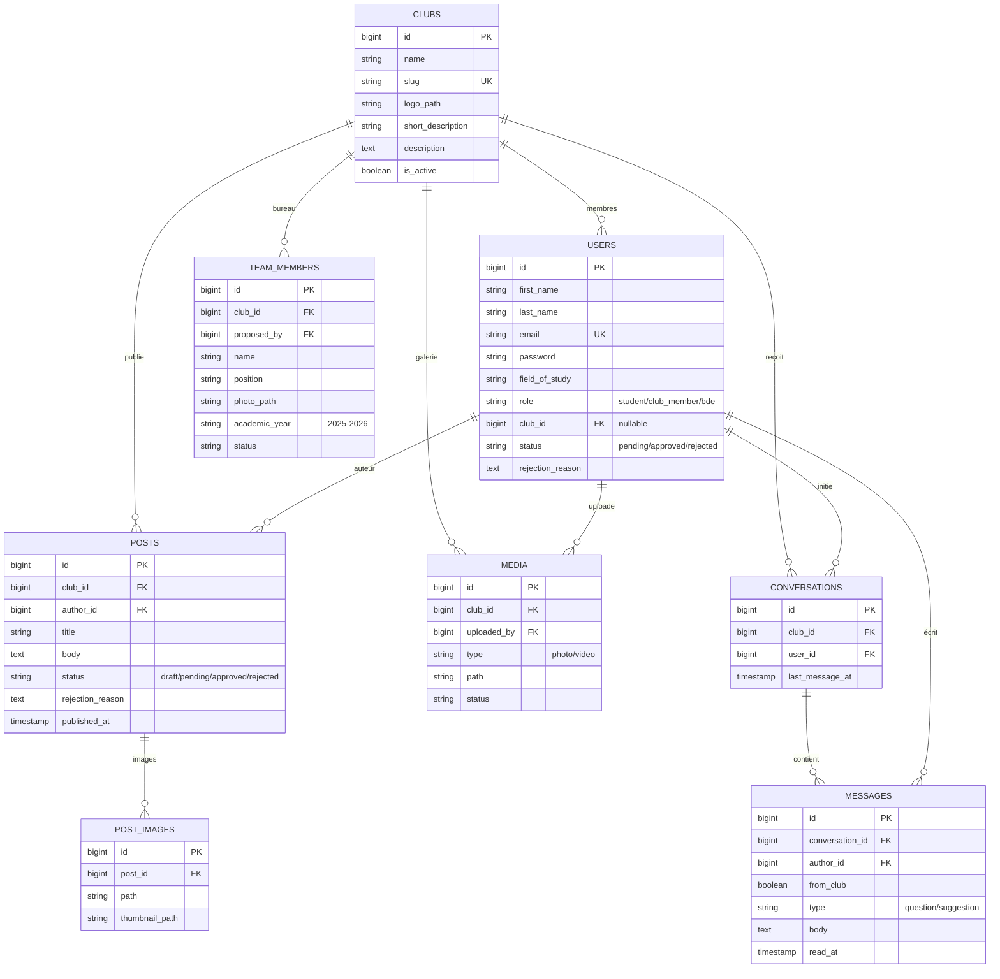

# ROADMAP.md — Ensaj Clubs

> **Instruction pour l'IA de code :** ce fichier est la spécification complète du projet. Implémente **tout le projet de bout en bout, dans l'ordre des phases (section 9), sans demander de validation entre les phases et sans poser de questions**. Toutes les décisions sont déjà prises ici. Si un détail manque, choisis la solution la plus simple qui respecte les règles de ce document, note-la dans le README (section « Choix techniques »), et continue. À la fin, exécute les tests, corrige les erreurs, puis donne un rapport final (fichiers créés, commandes pour lancer le site, comptes de démo, points non faits).

---

## 0. Contexte

**Ensaj Clubs** est un site web **local** qui présente les 11 clubs de l'ENSAJ : présentation de chaque club, posts (texte + images), galerie photos et vidéos, équipes de bureau (« Meet the Team »), et messagerie entre étudiants et clubs. Le **BDE** est l'administrateur : il valide tout ce qui est publié.

C'est un **projet universitaire de groupe** (cours de développement web) : le code doit être **simple, lisible, commenté en français aux endroits clés**, et facile à expliquer à un professeur. Pas de sur-ingénierie.

**Clubs (11) :** AIS, Hackademy, TGD, Takafen, Forum Entreprise, Olympics, SHIP, Enactus, Indensaj, CEC, Electrica.

---

## 1. Stack et règles imposées

| Élément | Décision |
|---|---|
| Backend | PHP + **Laravel 12 ou 11** selon la version de PHP disponible (`composer create-project laravel/laravel .`). Si PHP ≥ 8.2, utilise Laravel 11/12. |
| Base de données | MySQL (XAMPP/MariaDB), via **Eloquent** et des **migrations**. Base : `ensaj_clubs`, utilisateur `root`, mot de passe vide. |
| Frontend | **Blade + HTML5 + CSS3 + JavaScript vanilla** écrits à la main dans `public/css/` et `public/js/`. |
| Interdit | **Node, npm, Vite, Tailwind, Bootstrap, Alpine, Livewire, Inertia, React/Vue, jQuery, Breeze, Jetstream, Fortify, Spatie Permission.** Retire toute référence à `@vite` des vues générées. Les assets se chargent avec `asset('css/app.css')` et `asset('js/app.js')`. |
| Seul package à ajouter | `intervention/image` (v3, driver GD) pour redimensionner les images. |
| Langue | **Français uniquement.** Textes écrits directement dans les vues. `APP_LOCALE=fr`, `APP_TIMEZONE=Africa/Casablanca`. |
| Environnement | Local uniquement (`php artisan serve` + MySQL de XAMPP). Docker non utilisé. |
| `.env` | `SESSION_DRIVER=file`, `CACHE_STORE=file`, `QUEUE_CONNECTION=sync`, `MAIL_MAILER=log`. |
| Pas de | réinitialisation de mot de passe, emails, vérification d'email, commentaires, likes, audit/historique, suppression de comptes. |

**Principes de code :** MVC strict, `FormRequest` pour la validation, `Policy` pour les droits par ressource, un middleware `role` pour les zones, eager loading (`with`) pour éviter le N+1, jamais de logique métier dans les vues.

---

## 2. Acteurs et droits (cumulatifs)

Rôles (`users.role`) : `student`, `club_member`, `bde`. Le **visiteur** n'a pas de compte.

| Droit | Visiteur | Étudiant | Membre | BDE |
|---|:-:|:-:|:-:|:-:|
| Consulter accueil, clubs, posts, vidéos, Meet the Team | ✔ | ✔ | ✔ | ✔ |
| S'inscrire | ✔ | | | |
| Se connecter / déconnecter, page profil | | ✔ | ✔ | ✔ |
| Écrire à un club, consulter ses conversations | | ✔ | ✔ (pas son propre club) | ✔ |
| Notifications internes | | ✔ | ✔ | ✔ |
| Lire et répondre aux messages **de son club** | | | ✔ | |
| Créer / modifier les posts de son club, suivre leur statut | | | ✔ | |
| Proposer les fiches du bureau, uploader des médias de galerie | | | ✔ | |
| Tableau de bord du club | | | ✔ | |
| Ajouter / supprimer des posts (tous clubs) | | | | ✔ |
| Valider inscriptions, posts, fiches, médias | | | | ✔ |
| Attribuer les rôles (affecter à un club, promouvoir BDE) | | | | ✔ |
| Gérer les clubs, tableau de bord BDE | | | | ✔ |
| Supprimer une fiche du bureau ou un média | | | | ✔ |

**Cas particuliers :**
- Le BDE n'a **pas de club** (`club_id = NULL`) et **ne lit pas** les messages des clubs. Il peut **écrire** à un club comme un étudiant.
- Un étudiant appartient à **un seul club maximum** (`users.club_id`).
- Un membre peut modifier **tous les posts de son club** (pas seulement les siens).
- Un membre peut écrire aux **autres** clubs, mais **pas au sien**.
- Seul le BDE supprime (posts, fiches, médias). Les clubs ne se suppriment pas : on les **désactive** (`is_active`).

---

## 3. Règles de validation (workflow)

Statuts communs (enum PHP `Status`) : `draft` (posts seulement), `pending`, `approved`, `rejected`. « Publié » = `approved`.

1. **Inscription** : créée en `pending`. La **connexion est refusée avec un message** tant que le compte n'est pas `approved` (voir phase 2).
2. **Post** : le membre crée en `draft` → clique « Soumettre » → `pending` → le BDE valide (`approved`, `published_at = now()`) ou refuse (`rejected` + motif obligatoire). Un post créé **par le BDE** est directement `approved`.
3. **Fiche du bureau (team_members)** et **média de galerie (media)** : créés en `pending` → validés ou refusés par le BDE.
4. **Après la première validation, la modification est directe** : modifier un élément `approved` **ne le remet pas** en `pending`.
5. Un élément `rejected` affiche le **motif de refus** à son auteur. Il peut le corriger puis le **resoumettre** (post : bouton « Soumettre » ; fiche : toute modification la repasse en `pending` ; média : le membre uploade un nouveau média, pas d'édition).
6. Rien de ce qui n'est pas `approved` n'est visible publiquement.
7. À chaque validation/refus de post, fiche ou média, une **notification interne** est envoyée à l'auteur (voir phase 7). Les inscriptions n'ont pas de notification (l'utilisateur ne peut pas se connecter).

---

## 4. Base de données

### 4.1 Où stocker quoi

| Élément | Où |
|---|---|
| Comptes, clubs, posts, fiches, messages | **Base de données** |
| Fichiers (images, vidéos, logos) | **Disque** `storage/app/public/...` (`php artisan storage:link`), seul le **chemin relatif** est en base. Jamais de BLOB. |
| Les 11 clubs initiaux | **Seeder** lisant `database/seeders/data/clubs.php` |
| Gabarit de la page club | **Une seule vue** `public/clubs/show.blade.php` |

### 4.2 ERD



### 4.3 Migrations (ordre obligatoire, corps des `up()`)

Supprime la migration `password_reset_tokens` de la migration `users` par défaut. **La migration `add_club_id_to_users_table` doit être créée APRÈS `create_clubs_table`.** Les statuts/rôles sont des colonnes `string` castées vers des enums PHP.

```php
// 1. users (modifier la migration par défaut)
$t->id();
$t->string('first_name', 100);
$t->string('last_name', 100);
$t->string('email')->unique();
$t->string('password');
$t->string('field_of_study', 10);           // cp1 cp2 isic iite ccn gc gm gee gi
$t->string('role', 20)->default('student'); // student | club_member | bde
$t->string('status', 20)->default('pending');
$t->text('rejection_reason')->nullable();
$t->foreignId('validated_by')->nullable()->constrained('users')->nullOnDelete();
$t->timestamp('validated_at')->nullable();
$t->rememberToken();
$t->timestamps();
// (garder sessions ; supprimer password_reset_tokens)

// 2. clubs
$t->id();
$t->string('name', 100);
$t->string('slug', 120)->unique();
$t->string('logo_path')->nullable();
$t->string('short_description', 300);
$t->text('description');
$t->boolean('is_active')->default(true);
$t->timestamps();

// 3. add_club_id_to_users_table
$t->foreignId('club_id')->nullable()->after('role')->constrained('clubs')->nullOnDelete();

// 4. posts
$t->id();
$t->foreignId('club_id')->constrained()->cascadeOnDelete();
$t->foreignId('author_id')->constrained('users')->cascadeOnDelete();
$t->string('title', 200);
$t->text('body');
$t->string('status', 20)->default('draft');
$t->text('rejection_reason')->nullable();
$t->timestamp('published_at')->nullable();
$t->foreignId('validated_by')->nullable()->constrained('users')->nullOnDelete();
$t->timestamp('validated_at')->nullable();
$t->timestamps();
$t->index(['club_id', 'status', 'published_at']);

// 5. post_images
$t->id();
$t->foreignId('post_id')->constrained()->cascadeOnDelete();
$t->string('path');
$t->string('thumbnail_path')->nullable();
$t->unsignedSmallInteger('sort_order')->default(0);
$t->timestamps();

// 6. media (galerie Réels / vidéos)
$t->id();
$t->foreignId('club_id')->constrained()->cascadeOnDelete();
$t->foreignId('uploaded_by')->constrained('users')->cascadeOnDelete();
$t->string('type', 10);                      // photo | video
$t->string('path');
$t->string('thumbnail_path')->nullable();    // photos seulement
$t->string('title', 150)->nullable();
$t->string('mime_type', 100);
$t->unsignedBigInteger('size_bytes');
$t->string('status', 20)->default('pending');
$t->text('rejection_reason')->nullable();
$t->foreignId('validated_by')->nullable()->constrained('users')->nullOnDelete();
$t->timestamp('validated_at')->nullable();
$t->timestamps();

// 7. team_members
$t->id();
$t->foreignId('club_id')->constrained()->cascadeOnDelete();
$t->foreignId('proposed_by')->constrained('users')->cascadeOnDelete();
$t->string('name', 150);
$t->string('position', 100);
$t->string('photo_path')->nullable();
$t->string('academic_year', 9);              // 2025-2026
$t->unsignedSmallInteger('sort_order')->default(0);
$t->string('status', 20)->default('pending');
$t->text('rejection_reason')->nullable();
$t->foreignId('validated_by')->nullable()->constrained('users')->nullOnDelete();
$t->timestamp('validated_at')->nullable();
$t->timestamps();
$t->index(['club_id', 'academic_year', 'status']);

// 8. conversations (UN fil par étudiant et par club)
$t->id();
$t->foreignId('club_id')->constrained()->cascadeOnDelete();
$t->foreignId('user_id')->constrained()->cascadeOnDelete();
$t->timestamp('last_message_at')->nullable();
$t->timestamps();
$t->unique(['club_id', 'user_id']);

// 9. messages
$t->id();
$t->foreignId('conversation_id')->constrained()->cascadeOnDelete();
$t->foreignId('author_id')->constrained('users')->cascadeOnDelete();
$t->boolean('from_club')->default(false);    // true = réponse d'un membre du club
$t->string('type', 12)->nullable();          // question | suggestion (messages de l'initiateur)
$t->text('body');
$t->timestamp('read_at')->nullable();
$t->timestamps();
$t->index(['conversation_id', 'id']);

// 10. notifications : php artisan make:notifications-table
```

### 4.4 Enums PHP (`app/Enums`)

- `Role` : `Student='student'`, `ClubMember='club_member'`, `Bde='bde'`
- `Status` : `Draft='draft'`, `Pending='pending'`, `Approved='approved'`, `Rejected='rejected'` (avec une méthode `label()` en français et `badgeClass()` pour le CSS)
- `FieldOfStudy` : `cp1, cp2, isic, iite, ccn, gc, gm, gee, gi` (avec `label()` en majuscules)
- `MessageType` : `Question='question'`, `Suggestion='suggestion'`
- `MediaType` : `Photo='photo'`, `Video='video'`

Les modèles utilisent `casts()` vers ces enums.

### 4.5 Deux règles de cohérence à implémenter

**Rôle / club.** `club_member` ⇒ `club_id` non nul. `student` et `bde` ⇒ `club_id = NULL`. Une **seule** méthode `User::assignRole(Role $role, ?int $clubId)` modifie les deux champs ensemble. Toujours l'utiliser.

**Messages non lus avec un seul `read_at`.**
- Pour l'**initiateur** du fil : non lus = messages du fil avec `from_club = true` et `read_at IS NULL`.
- Pour un **membre du club** : non lus = messages des fils de son club (où il n'est pas l'initiateur) avec `from_club = false` et `read_at IS NULL`.
- À l'ouverture d'un fil, marquer comme lus les messages destinés au lecteur (`from_club = true` si le lecteur est l'initiateur, sinon `from_club = false`). La boîte du club est partagée : le premier membre qui ouvre le fil marque tout comme lu.
- Méthode `User::unreadMessagesCount()` utilisée dans le header.

---

## 5. Routes

Alias de middleware `role` (classe `EnsureRole`, enregistré dans `bootstrap/app.php` via `$middleware->alias([...])`). Usage : `->middleware('role:bde')`, `->middleware('role:club_member')`. Accès refusé ⇒ `abort(403)`.

| Zone | Routes (nom) |
|---|---|
| **Public** | `GET /` (home), `GET /clubs/{club:slug}` (clubs.show), `GET /clubs/{club:slug}/team?year=` (clubs.team) |
| **Invité** (`guest`) | `GET/POST /register`, `GET/POST /login` (`throttle:10,1` sur les POST) |
| **Connecté** (`auth`) | `POST /logout`, `GET/PUT /profile`, `PUT /profile/password`, `GET /notifications`, `POST /notifications/{id}/read` |
| **Messagerie** (`auth`) | `GET /clubs/{club:slug}/contact`, `POST /clubs/{club:slug}/conversations`, `GET /conversations`, `GET /conversations/{conversation}`, `POST /conversations/{conversation}/messages` (`throttle:30,1`), `GET /conversations/{conversation}/messages?after={id}` (JSON) |
| **Membre** (`auth`, `role:club_member`) préfixe `/manage` | `GET /manage/dashboard`, `resource /manage/posts` (**sans destroy**), `POST /manage/posts/{post}/submit`, `resource /manage/team` (**sans destroy**), `GET/POST /manage/media` (index, create, store) |
| **BDE** (`auth`, `role:bde`) préfixe `/admin` | `GET /admin/dashboard`, `GET /admin/moderation?tab=user\|post\|team\|media`, `POST /admin/moderation/{type}/{id}/approve`, `POST /admin/moderation/{type}/{id}/reject` (`{type}` contraint par `where('type','user\|post\|team\|media')`), `GET /admin/users`, `PATCH /admin/users/{user}/role`, `resource /admin/clubs` (**sans destroy ni show**), `GET/POST /admin/posts` + `DELETE /admin/posts/{post}` (index, create, store, destroy), `DELETE /admin/team/{teamMember}`, `DELETE /admin/media/{media}` |

« Contacter le club » : un visiteur est redirigé vers `/login` par le middleware `auth`, puis ramené automatiquement sur la page (comportement « intended » de Laravel). Le bouton est visible pour tous sur la page du club.

---

## 6. Structure du projet

```
app/
├── Enums/            Role, Status, FieldOfStudy, MessageType, MediaType
├── Http/
│   ├── Controllers/
│   │   ├── AuthController.php, ProfileController.php, NotificationController.php
│   │   ├── ConversationController.php
│   │   ├── Public/   HomeController, ClubController, TeamController
│   │   ├── Manage/   DashboardController, PostController, TeamController, MediaController
│   │   └── Admin/    DashboardController, ModerationController, UserController,
│   │                 ClubController, PostController, TeamController, MediaController
│   ├── Middleware/   EnsureRole.php
│   └── Requests/     RegisterRequest, ProfileRequest, PostRequest, TeamMemberRequest,
│                     MediaRequest, MessageRequest, ClubRequest, RejectRequest
├── Models/           User, Club, Post, PostImage, Media, TeamMember, Conversation, Message
├── Notifications/    ModerationResult.php, NewMessage.php
├── Policies/         PostPolicy, TeamMemberPolicy, MediaPolicy, ConversationPolicy
└── Services/         ImageService.php
database/
├── migrations/
└── seeders/          DatabaseSeeder, ClubSeeder, UserSeeder, DemoContentSeeder,
                      data/clubs.php, assets/logos/   (logos nommés {slug}.png)
public/
├── css/app.css       (variables :root, layout, composants)
├── js/               app.js, chat.js, gallery.js, upload-preview.js, team-year.js
└── images/           club-default.svg (image par défaut)
resources/views/
├── layouts/app.blade.php
├── components/       breadcrumb, club-card, status-badge, flash, avatar-initials
├── auth/             login, register
├── profile/          edit
├── public/           home, clubs/show, clubs/team
├── conversations/    index, show, contact
├── manage/           dashboard, posts/*, team/*, media/*
├── admin/            dashboard, moderation, users, clubs/*, posts/*
├── notifications/    index
└── errors/           403, 404
tests/Feature/
```

---

## 7. Design et frontend

- **Pas de charte graphique fournie** : utilise une palette sobre et moderne, **toutes les couleurs et polices en variables CSS dans `:root` de `public/css/app.css`** (`--color-primary`, `--color-primary-dark`, `--color-accent`, `--color-bg`, `--color-surface`, `--color-text`, `--color-muted`, `--color-border`, `--color-success`, `--color-warning`, `--color-danger`, `--font-main`, `--radius`, `--shadow`). L'équipe pourra ainsi changer la charte en un seul endroit.
- Police : pile système (`system-ui, -apple-system, "Segoe UI", Roboto, sans-serif`), pas de CDN externe (le site marche hors ligne).
- **Responsive mobile-first** : CSS Grid pour les grilles de cartes (`repeat(auto-fill, minmax(240px, 1fr))`), menu burger en JS vanilla (`app.js`) sous 768 px.
- **Header** : logo/nom « Ensaj Clubs » + navigation. À droite : **Se connecter / S'inscrire** pour un visiteur ; une fois connecté : nom (lien vers le profil), cloche de notifications avec compteur, icône messages avec compteur de non-lus, lien « Espace membre » (si `club_member`) ou « Administration » (si `bde`), bouton Se déconnecter (formulaire POST).
- **Fil d'Ariane** (composant `breadcrumb`) sur les pages publiques : *Accueil > [Club] > Meet the Team*.
- Tous les formulaires : `@csrf`, affichage des erreurs en français sous chaque champ, `old()`.
- Pages d'erreur 403 et 404 en français.
- Badges de statut colorés : brouillon (gris), en attente (orange), publié/validé (vert), refusé (rouge).
- **Photos manquantes** : composant `avatar-initials` (cercle avec initiales) pour les fiches sans photo, `club-default.svg` pour les clubs sans logo.
- JS vanilla uniquement, sans dépendance. Pour injecter du texte dynamique, utiliser **`textContent`**, jamais `innerHTML`. Pour les `fetch` POST, envoyer l'en-tête `X-CSRF-TOKEN` lu dans `<meta name="csrf-token">`.

---

## 8. Sécurité (obligatoire)

- Mots de passe hachés (`Hash`), `@csrf` partout, validation par `FormRequest`.
- **Mass-assignment** : `$fillable` explicite. `role`, `club_id`, `status`, `validated_by` ne sont **jamais** remplissables depuis un formulaire public ; ils sont modifiés uniquement par le code serveur (inscription → `student` + `pending`).
- **XSS** : toujours `{{ }}`. Le texte des posts et des messages s'affiche avec `{!! nl2br(e($texte)) !!}` (échappé d'abord). Aucun autre `{!! !!}` sur du contenu utilisateur.
- **Droits** : middleware `role` pour les zones + Policies pour chaque ressource (un membre n'agit que sur son club). Les requêtes partent des relations (`$user->club->posts()`), jamais d'un `find($id)` brut sans contrôle.
- **Conversations** : accès si `conversation.user_id == moi` **ou** (rôle `club_member` et `conversation.club_id == mon club`). Le BDE n'a aucun accès aux fils des autres.
- **Uploads** : valider le **type MIME réel** (`mimetypes:`), pas seulement l'extension ; nom de fichier aléatoire (`Str::random(40)`) ; stockage sur le disque `public` dans un sous-dossier (`logos/`, `posts/`, `media/`, `team/`) ; jamais le nom d'origine ; **supprimer le fichier physique sur disque (`Storage::disk('public')->delete(...)` via `ImageService::delete`) lors de la suppression de l'enregistrement** (posts, médias, fiches bureau, logos). Attention : `cascadeOnDelete()` en BDD ne supprime pas les fichiers du disque.
- **Limites** : images `jpeg,png,webp`, **5 Mo max**, **5 images max par post** ; vidéos `mp4,webm`, **50 Mo max**.
- `throttle` sur login, inscription et envoi de messages. Régénérer la session à la connexion, l'invalider à la déconnexion.

---

## 9. Phases d'implémentation (exécute-les toutes dans l'ordre)

### Phase 1 — Setup et socle
1. Créer le projet Laravel à la racine du dépôt actuel (`composer create-project laravel/laravel .`). `composer require intervention/image`.
2. Configurer `.env` et `.env.example` (section 1). Créer la base `ensaj_clubs` (`utf8mb4_unicode_ci`) si possible par ligne de commande (`mysql -u root -e "CREATE DATABASE IF NOT EXISTS ensaj_clubs CHARACTER SET utf8mb4 COLLATE utf8mb4_unicode_ci"`), sinon l'expliquer dans le README.
3. `php artisan storage:link`. Créer `database/seeders/assets/logos/` et `data/`.
4. Créer les enums, la structure de dossiers, `layouts/app.blade.php` (sans Vite), `public/css/app.css` avec les variables, `public/js/app.js` (menu burger, fermeture des messages flash), les composants Blade de base, les pages 403/404.
5. Initialiser Git (`.gitignore` : `.env`, `vendor`, `node_modules`, `storage/app/public/*` sauf `.gitignore`, etc.).
6. Écrire un premier `README.md` (installation pour le camarade, voir section 11).

**Terminé quand :** `php artisan serve` affiche le layout avec header et footer.

### Phase 2 — Authentification, profil, rôles, validation des inscriptions
- **Migrations** 1 (users, modifiée) et 3 (club_id) — la migration clubs (phase 3) doit exister avant : crée donc **toutes les migrations de la section 4.3 dès cette phase** dans le bon ordre et lance `php artisan migrate`.
- **Modèles** : `User` (casts enums, relations `club()`, `posts()`, `conversations()`, méthodes `isBde()`, `isClubMember()`, `assignRole()`, `unreadMessagesCount()`, accesseur `full_name`) et tous les autres modèles avec leurs relations, `$fillable`, casts et scopes (`approved()`, `pending()`).
- **Inscription** (`RegisterRequest`) : prénom, nom, email unique, mot de passe (min. 8, confirmation), filière (valeur de l'enum). Créer avec `role = student`, `status = pending`. Rediriger vers `/login` avec le message : *« Inscription enregistrée. Votre compte doit être validé par le BDE avant de pouvoir vous connecter. »*
- **Connexion** (`AuthController`) : 1) chercher l'utilisateur par email et vérifier le mot de passe (`Hash::check`) — si faux : erreur générique « Identifiants incorrects. » ; 2) **puis** contrôler le statut : `pending` → *« Votre compte est en attente de validation par le BDE. »* ; `rejected` → *« Votre inscription a été refusée. »* suivie du motif s'il existe ; 3) seulement si `approved` : `Auth::login($user, $remember)`, régénérer la session, rediriger vers l'URL voulue (`redirect()->intended()`) ou l'accueil. Déconnexion en POST.
- **`EnsureRole`** + alias `role`.
- **Profil** : modifier prénom, nom, filière (email affiché en lecture seule) ; changer le mot de passe (ancien mot de passe requis, `current_password`).
- **Admin — Modération, onglet `user`** : liste des inscriptions `pending`, boutons **Valider** et **Refuser** (formulaire avec motif obligatoire, `RejectRequest`). La validation remplit `status`, `validated_by`, `validated_at`.
- **Admin — Utilisateurs** : liste des comptes `approved` (recherche par nom/email, filtre par rôle). Formulaire de changement de rôle : `student` / `club_member` (+ choix du club **obligatoire**) / `bde`, via `assignRole()`. **Interdit de modifier son propre rôle.**
- **Vues** : login, register (menu déroulant des 9 filières), profil, `admin/moderation` (onglets), `admin/users`. JS : vérifier côté client que les deux mots de passe sont identiques.
- **Seeders** : `UserSeeder` (section 10).

### Phase 3 — Clubs et pages publiques de base
- `ClubSeeder` : lit `database/seeders/data/clubs.php` (tableau de 11 entrées : `name`, `slug`, `short_description`, `description`). **Crée ce fichier avec les 11 clubs** (slugs : `ais`, `hackademy`, `tgd`, `takafen`, `forum-entreprise`, `olympics`, `ship`, `enactus`, `indensaj`, `cec`, `electrica`) et des descriptions **provisoires** avec un commentaire `// TODO : remplacer par la vraie description`. Si `database/seeders/assets/logos/{slug}.png` existe, le copier vers `storage/app/public/logos/{slug}.png` et renseigner `logo_path` ; sinon laisser `logo_path` NULL (le site affiche l'image par défaut).
- `ImageService` (`app/Services`) : méthode `store(UploadedFile $f, string $dir, int $maxWidth, ?int $thumbWidth = null): array` (retourne `['path' => ..., 'thumbnail' => ...|null]`), encode en WebP (qualité ~80), nom aléatoire, `scaleDown` pour ne jamais agrandir ; méthode `delete(?string ...$paths)`. Driver GD.
- `Admin\ClubController` : index, create, store, edit, update (pas de suppression). Champs : nom, slug (généré depuis le nom à la création, non modifiable ensuite), description courte, description, logo (400 px de large), `is_active`. Aperçu du logo en JS (`upload-preview.js`, réutilisable par tous les formulaires avec `input[type=file][data-preview]`).
- `Public\HomeController` : clubs `is_active` triés par nom. Page **Accueil** : bandeau **« Welcome to Ensaj Clubs »**, fil d'Ariane, grille responsive de **cartes cliquables** (logo, nom, description courte) menant à `clubs.show`.
- `Public\ClubController@show` : **un seul gabarit** pour tous les clubs : titre **« Introduction de [nom] »**, texte de présentation, puis (ajoutés en phase 4) la galerie et les posts, et **deux boutons en bas de page** : **Contacter le club** (→ `conversations contact`) et **Meet the Team** (→ `clubs.team`). Un club inactif ou inexistant → 404.

### Phase 4 — Posts, galerie et modération
- **Membre — posts** (`Manage\PostController`, `PostPolicy`) : `index` (posts de **son** club, avec badges de statut et motif de refus), `create`/`store` (titre, texte simple, jusqu'à 5 images avec aperçu ; statut `draft`), `edit`/`update` (**modification directe**, ajout d'images jusqu'à 5 au total, suppression d'images existantes par cases à cocher ; le statut ne change pas), `submit` (`draft` ou `rejected` → `pending`, efface le motif). Pas de suppression. Images : `ImageService` (1600 px max + miniature 400 px) → table `post_images`.
- **Membre — médias** (`Manage\MediaController`) : `index` (ses médias du club avec statut), `create`/`store` : un fichier photo (`jpeg,png,webp`, 5 Mo) ou vidéo (`mp4,webm`, 50 Mo) + titre optionnel ; `type` déduit du MIME ; statut `pending`. Photos redimensionnées (1600 px + miniature), vidéos stockées telles quelles, `preload="metadata"`.
- **Admin — posts** (`Admin\PostController`) : `index` (tous les posts, filtre par club et par statut), `create`/`store` (le BDE choisit le club ; statut directement `approved`, `published_at = now()`, `validated_by` = lui), `destroy` (supprime le post et ses images sur disque).
- **Admin — médias** : `DELETE /admin/media/{media}` (supprime aussi le fichier).
- **`Admin\ModerationController`** : onglets `post` et `media` (en plus de `user` et `team`). `approve` : `status = approved`, `validated_by`, `validated_at` ; pour un post, aussi `published_at = now()`. `reject` : motif **obligatoire** (`RejectRequest`), `status = rejected`. Dans les deux cas, envoyer `ModerationResult` à l'auteur (phase 7). Implémenter avec un tableau associatif `type → classe de modèle` (pas de `switch` répété).
- **Page club (public)** : section **Réels / vidéos** (médias `approved`, grille de miniatures/vidéos, lightbox dans `gallery.js` : clic = agrandissement, `Échap` ou clic dehors = fermeture) et section **Posts** (posts `approved`, du plus récent au plus ancien par `published_at`, pagination de 10, texte avec `nl2br(e())`, images avec `loading="lazy"`).

### Phase 5 — Meet the Team
- `Manage\TeamController` (`TeamMemberPolicy`) : `index`, `create`/`store`, `edit`/`update` pour son club. Champs : nom, poste, année (`2025-2026`, validée par regex `^\d{4}-\d{4}$` avec la 2ᵉ année = 1ʳᵉ + 1), photo (carrée 400 px), ordre d'affichage. Création en `pending` ; **toute modification d'une fiche `rejected` la repasse en `pending`** (efface le motif) ; modifier une fiche `approved` reste direct. Pas de suppression côté membre.
- Onglet `team` de la modération (valider/refuser avec motif) + `Admin\TeamController@destroy` (supprime aussi la photo).
- **Page publique** `clubs.team` : titre **« Meet the Team »**, fil d'Ariane, **liste déroulante des années** (construite à partir des fiches `approved` du club, année la plus récente sélectionnée par défaut ; `team-year.js` soumet le formulaire GET au changement, avec un bouton « Afficher » dans une balise `<noscript>`), grille de cartes (photo ou initiales, nom, poste). **Uniquement les fiches `approved`.**

### Phase 6 — Messagerie
- `ConversationController` + `ConversationPolicy` + `MessageRequest` (corps 1–2000 caractères, `type` obligatoire pour les messages d'initiateur).
  - `contact` (GET `/clubs/{club}/contact`) : refuser (403 avec message clair) si l'utilisateur est membre de ce club. S'il existe déjà un fil (`club_id` + `user_id`), rediriger dessus ; sinon afficher le formulaire (choix **question / suggestion** + message).
  - `store` : crée le fil (`firstOrCreate`) et le premier message, met à jour `last_message_at`.
  - `index` (« Mes conversations ») : fils où je suis l'initiateur, triés par `last_message_at`, avec badge de non-lus. Si je suis membre : seconde section **« Messages reçus par mon club »**.
  - `show` : affiche le fil, **marque comme lus** les messages qui me sont destinés (règle 4.5).
  - `messages.store` : si je suis l'initiateur → `from_club = false`, `type` requis ; sinon (membre du club) → `from_club = true`, `type = null`. Met à jour `last_message_at`. Répond en JSON si la requête est AJAX (`expectsJson`), sinon redirige.
  - `messages.index` (JSON) : messages d'ID > `after`, avec auteur, date/heure formatées (`d/m/Y H:i`), type, `from_club`, `mine` (booléen).
- **Vue chat** (`conversations/show`) : en-tête (club ou étudiant, selon le lecteur), liste des messages (auteur, date et heure, badge **Question**/**Suggestion**, indicateur « non lu »), formulaire en bas. `chat.js` : envoi par `fetch` (sans recharger), **rafraîchissement toutes les 5 secondes** (`setInterval`, pause quand l'onglet est caché), défilement automatique vers le bas, rendu avec `textContent`.
- Compteur de non-lus dans le header (`unreadMessagesCount()`).
- Le **BDE** n'a accès qu'à ses propres fils (comme un étudiant).

### Phase 7 — Notifications et tableaux de bord
- **Notifications** (canal `database` uniquement) :
  - `ModerationResult` : envoyée à l'auteur après validation/refus d'un post, d'une fiche ou d'un média ; message du type *« Votre post « X » a été validé. »* / *« … a été refusé : motif »* ; lien vers l'élément.
  - `NewMessage` : envoyée au destinataire quand un message arrive (réponse du club → l'initiateur ; message d'un étudiant → **tous les membres** du club). **Sans doublon** : ne pas en créer une nouvelle s'il existe déjà une notification non lue pour ce même fil.
  - `NotificationController` : liste paginée, `read` (marque comme lue et redirige vers le lien). Cloche avec compteur dans le header.
- **Tableau de bord BDE** (`Admin\DashboardController`) : 4 cartes avec compteurs et liens directs (inscriptions, posts, fiches, médias **en attente**), plus liens vers Utilisateurs, Clubs, Posts.
- **Tableau de bord du membre** (`Manage\DashboardController`) : nom du club, compteurs de ses posts par statut (brouillon, en attente, publié, refusé), médias et fiches en attente/refusés, messages non lus, boutons « Nouveau post », « Proposer une fiche », « Ajouter un média », « Boîte du club ».

### Phase 8 — Finition, tests, documentation
1. **Seeders** : `UserSeeder`, `DemoContentSeeder` (quelques posts `approved` et `pending`, fiches du bureau `approved` pour 2 années, un fil de conversation avec quelques messages — pas de médias), appelés depuis `DatabaseSeeder` dans cet ordre : `ClubSeeder`, `UserSeeder`, `DemoContentSeeder`.
2. **Tests Feature** (PHPUnit, base de test : si l'extension `pdo_sqlite` est disponible utiliser SQLite en mémoire, sinon une base MySQL `ensaj_clubs_test`) :
   - Inscription crée un `student` `pending` ; `role=bde` dans la requête est ignoré.
   - Connexion refusée pour `pending` et `rejected` (avec le bon message), réussie pour `approved`.
   - Matrice routes × rôles : `/admin/*` → 403 pour étudiant et membre, 200 pour BDE ; `/manage/*` → 403 pour étudiant ; redirection vers `/login` pour un visiteur.
   - Un post `pending` n'apparaît pas sur la page club ; après `approve`, il apparaît.
   - Un membre du club A ne peut pas modifier un post du club B (403).
   - Modifier un post `approved` ne change pas son statut.
   - Une fiche `rejected` modifiée repasse en `pending` ; seules les fiches `approved` sont publiques.
   - Un étudiant ne peut pas ouvrir le fil d'un autre étudiant (403) ; un membre voit les fils de **son** club mais pas ceux d'un autre club ; le BDE ne voit pas les fils des clubs.
   - Un membre ne peut pas contacter son propre club.
   - Un fichier qui n'est pas une vraie image (ex. `.php` renommé `.jpg`) est refusé.
   - `assignRole()` garde `club_id` cohérent avec le rôle.
3. Vérifier à la main toutes les pages en largeur mobile (≈ 375 px) et en bureau.
4. Relire pour supprimer tout code mort, tout `dd()`, tout `{!! !!}` non sûr.
5. Finaliser `README.md` (section 11).

---

## 10. Comptes de démonstration (`UserSeeder`)

Mot de passe de tous : `password`.

| Email | Nom | Rôle | Statut | Remarque |
|---|---|---|---|---|
| `bde@ensaj.test` | BDE Admin | `bde` | approved | `club_id` NULL |
| `etudiant@ensaj.test` | Étudiant Test | `student` | approved | filière `gi` |
| `attente@ensaj.test` | En Attente | `student` | pending | pour montrer le refus de connexion |
| `refuse@ensaj.test` | Refusé Test | `student` | rejected | motif : « Informations incomplètes. » |
| `membre.ais@ensaj.test` | Membre AIS | `club_member` | approved | club AIS |
| `membre.hackademy@ensaj.test` | Membre Hackademy | `club_member` | approved | club Hackademy |

**Scénario de démonstration à rendre possible :** inscription → connexion refusée (en attente) → le BDE valide → l'étudiant écrit à un club → un membre du club répond → le membre crée un post et propose une fiche du bureau → le BDE les valide → le visiteur les voit sur le site.

---

## 11. README.md à produire

Doit contenir, en français :
1. Présentation courte du projet et des rôles.
2. **Prérequis** : XAMPP (MySQL démarré), PHP ≥ 8.3 (ou 8.2 si Laravel 12), Composer, extension GD activée (`extension=gd` dans `php.ini`).
3. **Installation (pour un camarade, à partir de zéro) :**
   ```
   git clone <url> && cd ensaj-clubs
   composer install
   cp .env.example .env          (Windows : copy .env.example .env)
   php artisan key:generate
   # créer la base ensaj_clubs dans phpMyAdmin (utf8mb4_unicode_ci)
   php artisan migrate:fresh --seed
   php artisan storage:link
   php artisan serve
   ```
   Puis ouvrir `http://127.0.0.1:8000`.
4. **Réglage `php.ini` de XAMPP** pour les vidéos : `upload_max_filesize=64M`, `post_max_size=70M`, puis redémarrer Apache.
5. Comptes de démonstration (section 10) et scénario de démo.
6. **Où mettre les vraies données** : descriptions des clubs dans `database/seeders/data/clubs.php`, logos dans `database/seeders/assets/logos/{slug}.png`, puis `php artisan migrate:fresh --seed`. **Où changer la charte graphique** : variables `:root` de `public/css/app.css`.
7. **Travail en équipe avec Git** : ne **jamais** commiter `.env`, `vendor/` ni `storage/app/public/` ; ne **jamais** échanger de dump SQL ; la base se recrée avec `migrate:fresh --seed`. Branches courtes, commits fréquents.
8. Lancer les tests : `php artisan test`.
9. Section « Choix techniques » (dont toute décision prise par l'IA en dehors de ce document).
10. Structure des dossiers (version courte de la section 6).

---

## 12. Hypothèses déjà tranchées (ne pas redemander)

1. Un membre modifie **tous** les posts de son club.
2. La filière est un champ unique (cp1, cp2, isic, iite, ccn, gc, gm, gee, gi) ; pas de niveau séparé.
3. Un membre peut écrire aux autres clubs, pas au sien.
4. Fiches et médias suivent la même règle que les posts : validés une fois, ensuite modifiables directement (pour les fiches).
5. Les membres ne suppriment rien ; seul le BDE supprime.
6. Les vidéos ne sont que dans la galerie (pas dans les posts) ; les posts contiennent texte + images.
7. Aucune notification pour les inscriptions.
8. Le site n'est consulté que depuis la machine locale ; aucune configuration de production n'est demandée.

---

## 13. Définition de « terminé »

- [ ] `php artisan migrate:fresh --seed` fonctionne sans erreur sur une base vide.
- [ ] Les 11 clubs s'affichent sur l'accueil et chaque page club fonctionne avec le même gabarit.
- [ ] Le scénario de démonstration (section 10) se déroule sans erreur avec les 6 comptes.
- [ ] Les 4 rôles ne peuvent faire que ce que prévoit la section 2 (tests de la phase 8 passent).
- [ ] Aucun fichier Node/Vite/Tailwind, aucune dépendance front externe, aucun CDN.
- [ ] Le site est utilisable sur téléphone.
- [ ] `README.md` permet à un camarade d'installer le projet de zéro en moins de 10 minutes.
